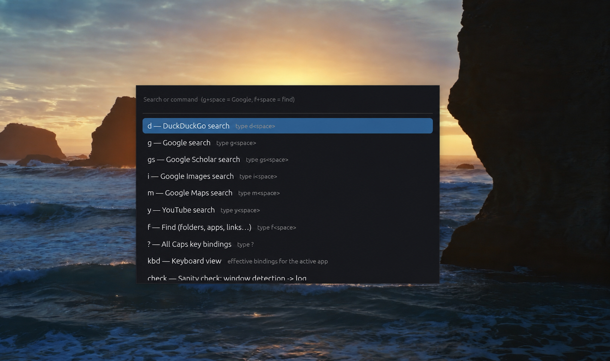
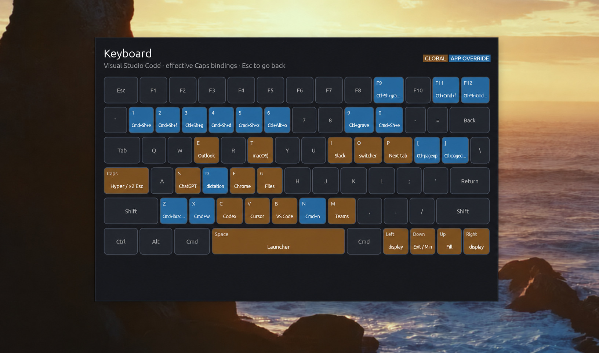

# zack

Zack turns Caps Lock into a keyboard launcher for macOS, Windows, and Linux.
Open apps, search the web, jump to projects, and control windows.

- Tap `Caps` once by itself to do nothing, or twice quickly to press `Esc`.
- Hold `Caps` and press `Space` to open Zack's menu.
- Hold `Caps` and press a letter to open an app, website, or folder immediately.
- Use the menu to search the web, find folders, and run useful commands.

You choose the shortcuts. Zack can also use different shortcuts depending on
which app you are using. For example, the same key can open a VS Code panel,
switch a browser tab, or move a window.

## What it looks like



## What Zack can do

- Open apps, websites, folders, and VS Code or Cursor projects
- Search Google, DuckDuckGo, YouTube, Maps, and other sites
- Find saved items by typing part of their name
- Use different shortcuts in VS Code, Cursor, Slack, and browsers
- Bring an already-open app to the front on macOS and Windows
- Move and resize windows from the keyboard on macOS and Windows
- Reload shortcut changes without restarting Zack

On Windows and Linux, Zack uses
[Kanata](https://github.com/jtroo/kanata) to tell the difference between tapping
and holding Caps Lock. On macOS, it uses the keyboard tools built into the
operating system, so Kanata and Karabiner are not needed.

## Install

Zack is currently installed from this repository. Run the commands below from
the main Zack folder. For step-by-step tool installation and verification on
each platform, follow the [prerequisite setup guide](docs/installation.md).

### macOS

Requirements: [rustup](https://rustup.rs) and the Xcode command-line tools.

```sh
scripts/build-macos.sh
scripts/install/macos.sh
```

The installer asks for your administrator password once so the Caps Lock change
keeps working after a restart. When System Settings opens, add and enable
`~/.local/bin/zack` under **Privacy & Security → Accessibility**, then restart
Zack:

```sh
launchctl kickstart -k "gui/$(id -u)/com.zack.launcher"
```

For optional `Caps+D` system dictation, enable Dictation and set its shortcut
to **Press Right Command Key Twice** in System Settings → Keyboard.

### Linux (X11)

Requirements: Docker, Rust/Cargo, and Kanata. See the
[Kanata setup guide](kanata/README.md) for alternatives to installing it with
Cargo.

```sh
cargo install --locked --version 1.11.0 kanata
scripts/build-in-container.sh
scripts/install/linux.sh
```

The installer gives Zack permission to read the keyboard and sets it to start
automatically. Log out and back in once after the first install. Wayland is not
currently supported.

### Windows

Requirements: PowerShell, Docker Desktop or Rancher Desktop, and Kanata. See
the [Kanata setup guide](kanata/README.md) for the version that runs quietly in
the background.

```powershell
.\scripts\build-in-container.ps1
.\scripts\install\windows.ps1
```

The installer needs no administrator access. It installs Zack and Kanata for
the current user and starts both automatically at login.

### Install on another computer

To install Zack without copying the full repository, make a ready-to-copy
package for the other computer. First follow the
[release setup](docs/releasing.md) to generate its license materials:

```sh
scripts/make-bundle.sh linux
scripts/make-bundle.sh windows
scripts/make-bundle.sh macos arm64   # build on a Mac first
```

The packages are saved in `dist/` and include installation instructions,
dependency notices and the accompanying source archives. Packaging requires
Python 3.9+ after notice generation and internet access for any source archives
absent from the local cache. Generated reports stay under ignored `dist/`.

## Everyday use

In the table below, `Caps+key` means hold Caps and tap the other key.

| Input | Result |
|---|---|
| `Caps+Space` | Show or hide the chooser on the monitor containing the pointer |
| `Caps+letter` | Run a direct app, URL, or path shortcut |
| `g␠ <query>⏎` | Search Google; other prefixes select other search engines |
| `f␠ <fuzzy>⏎` | Find a configured folder, link, app, or Cursor workspace |
| `?⏎` | Show all direct and app-context Caps bindings |
| `kbd⏎` | Show the visual keyboard with effective bindings for the active app |
| `rel⏎` | Reload configuration and global hotkeys without restarting |
| `config⏎` / `dir⏎` | Open the active config file or its directory |
| `Caps+F11` | Toggle native full-screen mode on macOS |
| `Caps+[` / `Caps+]` | Previous or next tab using the active app's mapping |
| `Caps+arrows` | Manage the active window on macOS and Windows |
| tap `Caps` once | Do nothing |
| double-tap `Caps` | Send `Esc` |

The context-aware keyboard view:



Press `Esc`, or Backspace on an empty query, to return to the chooser root.
Press `Esc` at the root to hide it.

## Configuration

Zack keeps its shortcuts in a plain text settings file named `mappings.json`.
The main settings file is
[`launcher/mappings.json`](launcher/mappings.json). For a smaller starting
point, use [`launcher/mappings.example.json`](launcher/mappings.example.json).

Keep private or computer-specific shortcuts in a file named
`mappings.local.json` beside `mappings.json`. Git ignores this file, so it will
not be included by accident when you share your changes. Zack combines the two
files when it starts; a shortcut in the local file replaces one with the same
name in the main file. App-specific shortcuts in the local file are checked
first. See
[`launcher/mappings.local.example.json`](launcher/mappings.local.example.json)
for an example.

```jsonc
{
  "modes": {
    "g": {
      "label": "Google",
      "url": "https://www.google.com/search?q={query}"
    }
  },
  "folders": {
    "down": { "label": "Downloads", "path": "~/Downloads" },
    "repo": {
      "label": "Project in Cursor",
      "cursor_uri": "~/code/my-project"
    }
  },
  "hotkeys": {
    "f": {
      "label": "Browser",
      "app": {
        "macos": "Google Chrome",
        "linux": "google-chrome",
        "windows": "chrome"
      }
    }
  },
  "contexts": [
    {
      "label": "VS Code panes on Windows",
      "match": { "windows": ["Code.exe"] },
      "keys": { "1": "ctrl+shift+e", "9": "ctrl+grave" }
    }
  ]
}
```

| Setting | What it controls | Example |
|---|---|---|
| `modes` | Web searches with a `{query}` placeholder | `g cats` searches Google |
| `folders` | Saved folders, websites, and local or remote editor projects | `f project` finds a project |
| `hotkeys` | Apps, websites, or folders opened with Caps plus a letter or number | `Caps+f` opens Chrome |
| `commands` | Built-in actions | `rel` reloads settings |
| `contexts` | Shortcuts for a particular Windows or macOS app | `Caps+1` opens the editor's Explorer |
| `cursor_cli` | Editor command used by every `cursor_uri` entry | `code` for VS Code; `cursor` by default |

### Open a remote project in VS Code

Install VS Code's [Remote - SSH extension](https://code.visualstudio.com/docs/remote/ssh)
and make the `code` command available on your PATH. Configure and connect to
your SSH host in VS Code once, then add this to `mappings.local.json`:

```json
{
  "cursor_cli": "code",
  "folders": {
    "remote": {
      "label": "Remote project in VS Code",
      "cursor_uri": "vscode-remote://ssh-remote+devbox/home/dev/code/my-project"
    },
    "local": {
      "label": "Local project in VS Code",
      "cursor_uri": "~/code/my-project"
    }
  }
}
```

Replace `devbox` with your SSH host alias and the path with your remote project
directory. Keep real work hosts and paths in the private overlay. Type `rel`,
then open the chooser and type `f remote` followed by Enter. Zack runs the
[same command supported by VS Code](https://code.visualstudio.com/docs/remote/troubleshooting#_connect-to-a-remote-host-from-the-terminal):

```sh
code --folder-uri "vscode-remote://ssh-remote+devbox/home/dev/code/my-project"
```

The `cursor_uri` field name is retained for compatibility; `cursor_cli` selects
the editor for all project entries. Use `cursor` instead of `code` for Cursor.

| Shortcut while VS Code or Cursor is focused | Windows | macOS |
|---|---|---|
| `Caps+1` | Explorer | Explorer |
| `Caps+2` | Search | Search |
| `Caps+[` / `Caps+]` | Previous / next tab | Previous / next tab |

These bindings come from `contexts` in the public configuration and can be
overridden in the private overlay.

If the settings contain a mistake, Zack shows the problem in its menu. Fix the
file and type `rel` to try again.

### Where the settings file lives

| How Zack was installed | Settings file |
|---|---|
| macOS or Windows from this repository | `launcher/mappings.json` in this repository |
| Linux | `~/.config/zack/mappings.json` |
| macOS bundle | `~/Library/Application Support/zack/mappings.json` |
| Windows bundle | `%APPDATA%\zack\mappings.json` |

The installers do not replace settings you have already changed.

## Platform notes

| | Linux | macOS | Windows |
|---|---|---|---|
| How Caps Lock works | Kanata | Built-in macOS keyboard tools | Kanata |
| Supported desktop | X11 | macOS | Windows |
| Bring an open app to the front | Launch only | Yes | Yes |
| Different shortcuts for each app | No | Yes | Yes |
| Window management | No | Yes | Yes |
| One-time setup | Keyboard access | Accessibility permission | None for normal windows |

Important limitations:

- Zack treats held Caps Lock as `Ctrl+Alt+Shift`. It does not include the
  Windows key because Windows reserves that key combination for Office.
- Zack's shortcuts do not work inside Windows apps opened as administrator.
- Linux needs a recent distribution, such as Debian 12 or Ubuntu 23.04 or
  newer, and does not support Wayland.
- Zack has no tray icon; use the commands below to inspect or restart it.

## Operations

| | Linux | macOS | Windows |
|---|---|---|---|
| Status | `systemctl --user status zack kanata` | `launchctl print gui/$UID/com.zack.launcher` | Task Manager |
| Restart | `systemctl --user restart zack kanata` | `launchctl kickstart -k gui/$UID/com.zack.launcher` | Run `zack` in a new terminal |
| Logs | `journalctl --user -u zack -u kanata -e` | `~/Library/Logs/zack.log` | `%APPDATA%\zack\zack.log` |

The `check` menu command records which app is open and which shortcuts Zack
selected. This information is useful when a shortcut does not work. Only one
copy of Zack can run at a time.

On Windows installs made from this repository, the `update` menu command pulls
the configured upstream, builds and tests the source in Docker, and reinstalls
Zack only if those steps succeed. Docker must be running. If an update fails,
fix the reported error, rebuild, and rerun the installer. On macOS and Linux, update the local
repository, rebuild, and rerun the installer. For shortcut changes, type `rel`;
there is no need to reinstall.

## Development

Run the Rust checks locally:

```sh
cd launcher
cargo test
cargo clippy --all-targets -- -D warnings
```

Build Linux and Windows release binaries in the pinned container environment:

```sh
scripts/build-in-container.sh
```

The main implementation is split between configuration and validation
(`mappings.rs`), pure chooser behavior (`logic.rs`), platform actions
(`actions.rs`), monitor placement (`placement.rs`), chord parsing
(`chords.rs`), and the egui event loop (`main.rs`).

## Acknowledgements

Zack follows an earlier
[AutoHotkey launcher](https://github.com/a-nau/AutoHotKey-GUI-and-Commands).
It is built with
[kanata](https://github.com/jtroo/kanata),
[egui/eframe](https://github.com/emilk/egui),
[global-hotkey](https://github.com/tauri-apps/global-hotkey), and
[nucleo](https://github.com/helix-editor/nucleo).

## License and security

Zack's original code is available under the [MIT license](LICENSE).
Dependencies keep their own licenses; see [third-party notices](THIRD-PARTY-NOTICES.md).
Read [SECURITY.md](SECURITY.md) before sharing settings or diagnostic logs.
